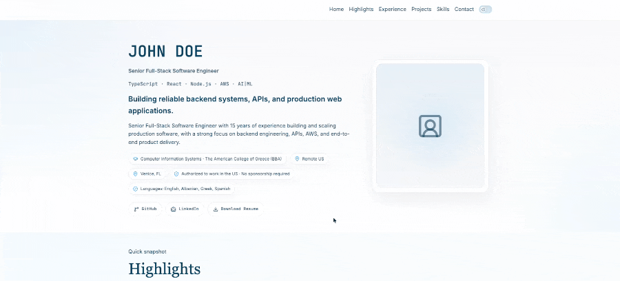
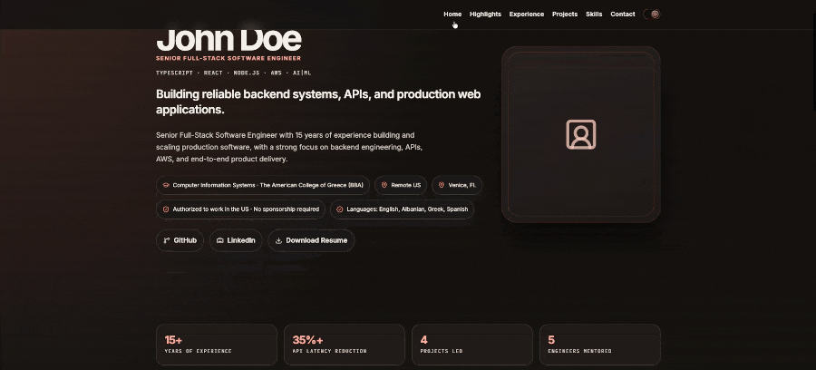
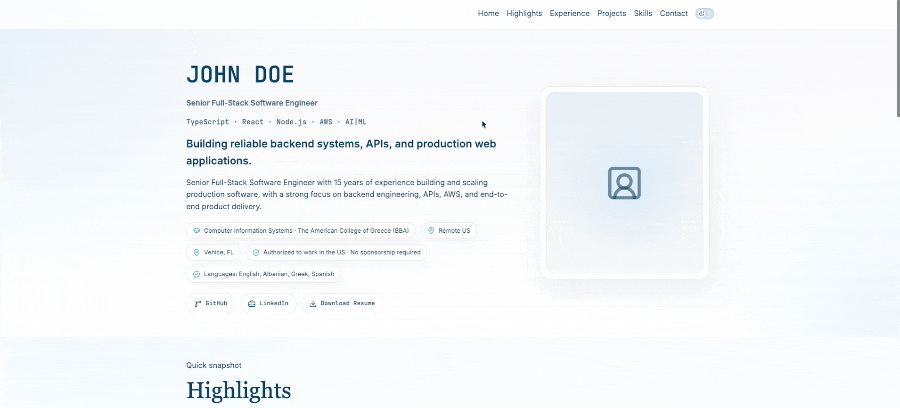
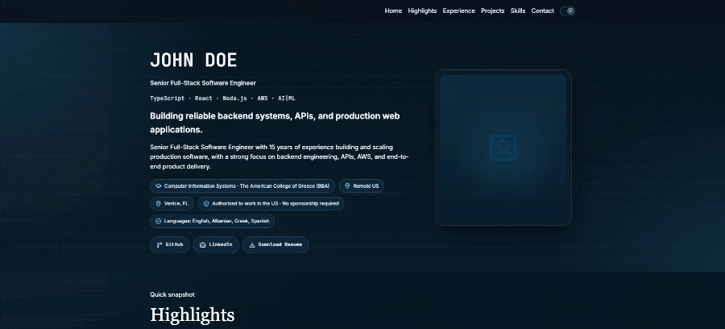
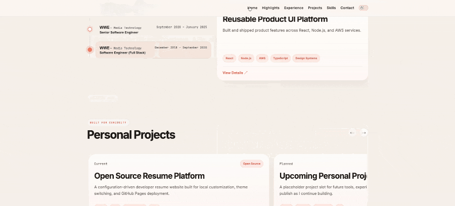
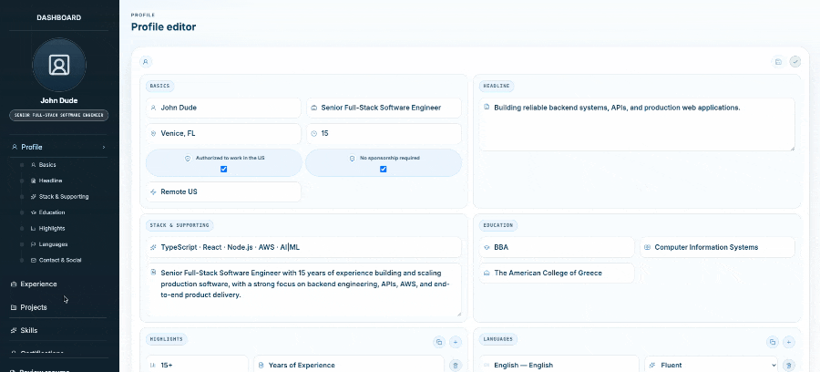

# Developer Resume Website Template

A free, customizable developer resume website built with React and TypeScript. Create a professional online resume and portfolio, showcase your skills and experience, and deploy your website to GitHub Pages.

Designed for developers and job seekers who want a modern personal website without paying for hosting or maintaining a backend.

<p align="center">
  <a href="https://teodortoni.github.io/resume/">Live demo</a>
  ·
  <a href="https://github.com/teodortoni/resume">GitHub</a>
</p>
<p align="center">
  <a href="https://react.dev/"></a>
  <a href="https://www.typescriptlang.org/"></a>
  <a href="https://vite.dev/"></a>
  <a href="https://github.com/teodortoni/resume/actions/workflows/deploy.yml"></a>
  <a href="https://github.com/teodortoni/resume/blob/main/LICENSE"></a>
  <a href="https://github.com/teodortoni/resume/stargazers"></a>
  <a href="https://github.com/teodortoni/resume/network/members"></a>
</p>


<h2>🎨 Resume Themes</h2>

<p>Choose from two responsive themes, each supporting light and dark mode.</p>

<table border="0" cellpadding="24" cellspacing="0" width="100%">
  <tr>
    <td align="center" width="50%">
      <p><strong>Default Theme · Light</strong></p>
      
    </td>
    <td align="center" width="50%">
      <p><strong>Modern Theme · Light</strong></p>
      
    </td>
  </tr>
</table>

<details>
  <summary><strong>🌙 Explore dark mode themes</strong></summary>

  <br />

  <table border="0" cellpadding="24" cellspacing="0" width="100%">
    <tr>
      <td align="center" width="50%">
        <p><strong>Default Theme · Dark</strong></p>
        
      </td>
      <td align="center" width="50%">
        <p><strong>Modern Theme · Dark</strong></p>
        
      </td>
    </tr>
  </table>
</details>

<h2>⚙️ Local Dashboard</h2>

<p>
  Customize your resume content locally without a backend or database.
</p>

<details>
  <summary><strong>👤 Profile & Highlights Editor</strong></summary>

  <br />

  <table border="0" cellpadding="24" cellspacing="0" width="100%">
    <tr>
      <td align="center">
        <p><strong>Profile & Highlights</strong></p>
        
      </td>
    </tr>
  </table>
</details>

<br />

<details>
  <summary><strong>💼 Experience Editor</strong></summary>

  <br />

  <table border="0" cellpadding="24" cellspacing="0" width="100%">
    <tr>
      <td align="center">
        <p><strong>Work Experience</strong></p>
        
      </td>
    </tr>
  </table>
</details>


## Why Use This Project?

- Free and open source: Build your own professional resume website.
- Customizable: Personalize your resume content and appearance.
- Modern technology: Built with React, TypeScript, and Vite.
- Static deployment: Publish your site using GitHub Pages.
- Developer-focused: Showcase your experience, skills, projects, and achievements in one place.

## Features

- JSON-driven resume content
- Dashboard for editing profile, experience, skills, and projects
- `default` and `modern` theme variants
- Responsive resume layout
- Build-time SEO injection into static HTML
- JSON-LD `schema.org/Person` metadata
- `<noscript>` semantic CV content for crawlers and non-JS visitors
- Static deployment to GitHub Pages
- Print-friendly styling
- No database or backend required

## Quick start

```bash
git clone https://github.com/teodortoni/resume.git
cd resume
npm install
npm run dev
```

Open:

- `http://localhost:5173/`
- `http://localhost:5173/dashboard`

## How it works

### Resume content

The main content lives in:

- `src/resume/data/resume.json`

This file contains the profile, experience, projects, skills, languages, and optional certifications.

### Site configuration

Site-level configuration lives in:

- `src/resume/data/site.config.json`

This controls:

- `siteTitle`
- `theme`
- section visibility (`showProfile`, `showExperience`, etc.)
- optional resume asset path

### Theme system

Themes are registered in:

- `src/themes/registry.js`

Available themes:

- `default`
- `modern`

### Dashboard

The dashboard is the editing surface for local updates. It reads and writes the JSON files so changes can be made without a backend. This makes the app easy to maintain as a lightweight static portfolio.

## Customize your resume

Update the project files below to fit your own profile:

```text
src/resume/data/resume.json
src/resume/data/site.config.json
```

Typical edits include:

- your name, title, location, email, and social links
- work experience and project details
- skills groups and certifications
- visibility of each section of the resume
- theme selection

## Deployment

This project is configured for GitHub Pages.

```text
clone → update content → run locally → commit → push to main → GitHub Actions builds → Pages deploys
```

Workflow file:

- `.github/workflows/deploy.yml`

The project is published under:

- https://teodortoni.github.io/resume/

GitHub Pages configuration in the app is set with:

- `package.json` → `"homepage": "https://teodortoni.github.io/resume/"`
- `vite.config.js` → `base: "/resume/"`

## SEO and ATS support

SEO/ATS metadata is generated at build time from your JSON config and injected into the static HTML:

- `title`, `description`, canonical, Open Graph, and Twitter meta tags
- JSON-LD `Person` structured data in `<head>`
- Full semantic resume content inside `<noscript>`

This allows crawlers to read your resume content even when JavaScript is not executed.

## Project structure

```text
resume/
├── .github/workflows/deploy.yml
├── src/
│   ├── App.jsx
│   ├── components/
│   ├── dashboard/
│   ├── resume/
│   │   ├── data/
│   │   └── types/
│   ├── styles/
│   └── themes/
├── package.json
├── vite.config.js
├── README.md
└── dist/
```

## Roadmap

Current V1 scope:

- JSON-driven resume content
- theme switching
- local dashboard editing
- responsive static portfolio
- GitHub Pages deployment

## Contributing

Contributions are welcome. Keep changes focused and aligned with the project’s static, configuration-driven structure.

## License

This project is licensed under the [MIT License](./LICENSE).
